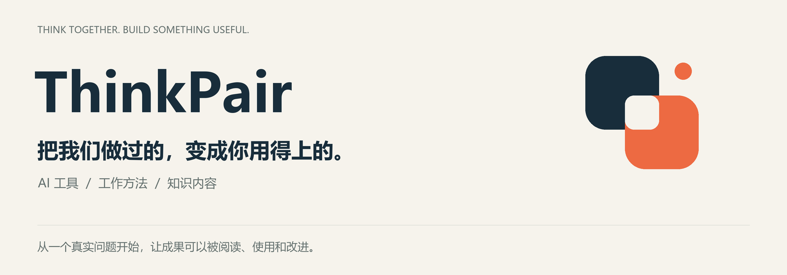

  

我们用 AI 解决学习、研究与创作中的实际问题，也把过程中做出的工具、方法和知识内容，陆续整理开放。

**从一份能用的成果开始。** 看它解决什么问题，打开一个示例，再决定是否值得带进自己的工作。

## 先挑一件对你有用的

### 想弄懂一家公司靠什么赚钱？

**[降噪星图 · 市场观察器与行业知识库](https://github.com/ZHY999999999/jiangzao-xingtu-open-source)**

从产品、客户与收入开始，读一家公司，再横着比较一个行业。保留公开资料出处，持续更新知识库内容。

**现在就能得到：** 可直接阅读的公司笔记与行业入口，无需安装。

[从一个具体问题读起 →](https://github.com/ZHY999999999/jiangzao-xingtu-open-source#先选一个你想弄明白的问题)

### 换个 AI 对话，还要从头解释项目？

**[ThinkPair Starter Kit · AI 项目接手模板](https://github.com/ZHY999999999/thinkpair-starter-kit)**

用几份简单的 Markdown 文件，把目标、当前进度、下一步与依据留在项目里。换对话或换协作者时，有清楚的接手入口。

**现在就能得到：** 空白模板、完整虚构示例与使用步骤。先试一个小项目，再按需要扩展。

[打开模板与示例 →](https://github.com/ZHY999999999/thinkpair-starter-kit#readme)

## 我们还在做什么

**一人成校**：围绕一份学习材料，连接成人核实、针对练习与复测反馈。当前为受邀使用的产品，仍在打磨实际使用过程。

随着整理推进，这里会继续开放：

| 你想做什么 | 我们会整理什么 |
| :--- | :--- |
| 用一个工具解决实际问题 | 独立小工具、可运行示例与说明 |
| 学会一套完成事情的方法 | AI Skills、协作模板、设计与创作流程 |
| 更清楚地理解一个主题 | 知识内容、专题笔记与项目复盘 |

## 为什么值得回来

我们希望每次开放的成果，都能说清楚三件事：**有什么用、怎样开始、目前做到哪一步。**

这里也会记录制作过程中的选择与修正。成果按实际整理进度发布；公开源码、运行条件与使用效果分别说明。

**关注 ThinkPair，继续发现可以带走的工具、方法和知识。**

发现问题或想提出建议，请到对应项目留下具体场景；欢迎从修正一条说明、补充一个示例开始参与。
